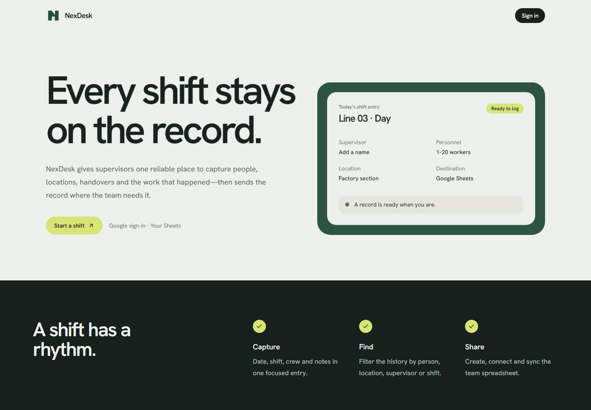
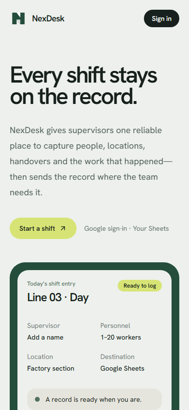
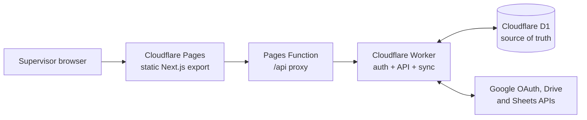

# NexDesk

NexDesk is a factory shift-record application. Supervisors log a shift, crew, location, and remarks; managers can search the full history and export a simple PDF. D1 is the source of truth and each user can sync their records to a Google Sheet.

[Live app](https://nexdesk-d3t.pages.dev) · [Architecture](docs/ARCHITECTURE.md) · [Deployment](docs/DEPLOYMENT.md) · [Decisions and fixes](docs/DECISIONS_AND_FIXES.md)



<p align="center">
  
</p>

## What it does

- Google sign-in with a persistent, secure session
- Shift records with day/night shift, supervisor, factory, location, workers, and optional remarks
- Per-user suggestions for workers, supervisors, factories, and locations
- Fast D1-backed history filtering, including exact-day filtering and pagination
- Plain tabular PDF export
- Per-user Google Sheets discovery, automatic spreadsheet creation, and background sync
- Light and dark modes

## Architecture



The app reads records and suggestions from D1. Google Sheets receives synced copies; it is not used as the live query database.

## Stack

- Next.js 16, React 19, TypeScript, Tailwind CSS
- Cloudflare Pages, Pages Functions, Workers, and D1
- Google OAuth 2.0, Drive API, and Sheets API
- jsPDF + AutoTable for client-side PDF generation

## Local setup

Prerequisites: Node.js 20+ and a Cloudflare account for the hosted services.

```powershell
npm install
copy .env.example .env
npm run dev
```

For the Cloudflare API, install Wrangler and configure `worker/wrangler.jsonc` with your own D1 database binding. Do not use this repository's deployed Worker URL for a fork.

## Configure Google OAuth

1. Create a Web application OAuth client in Google Cloud Console.
2. Enable Google Drive API and Google Sheets API.
3. Add the Pages URL as an authorized JavaScript origin.
4. Add `https://YOUR-PAGES-DOMAIN/api/auth/google/callback` as the authorized redirect URI.
5. Set the Worker secrets described in [Deployment](docs/DEPLOYMENT.md).

Never commit OAuth secrets, session secrets, refresh tokens, or a local D1/SQLite database.

## Development commands

```powershell
npm run dev
npm run build
npm test
npx wrangler deploy --config worker/wrangler.jsonc
npx wrangler pages deploy out --project-name YOUR_PROJECT --branch main
```

## Documentation

- [Architecture](docs/ARCHITECTURE.md): components, data flow, and ownership boundaries
- [Deployment](docs/DEPLOYMENT.md): Cloudflare and Google OAuth setup
- [Decisions and fixes](docs/DECISIONS_AND_FIXES.md): problems encountered and the implemented fixes
- [Contributing](CONTRIBUTING.md): local contribution workflow
- [Security policy](SECURITY.md): reporting process and secret-handling expectations

## License

Released under the [MIT License](LICENSE).
