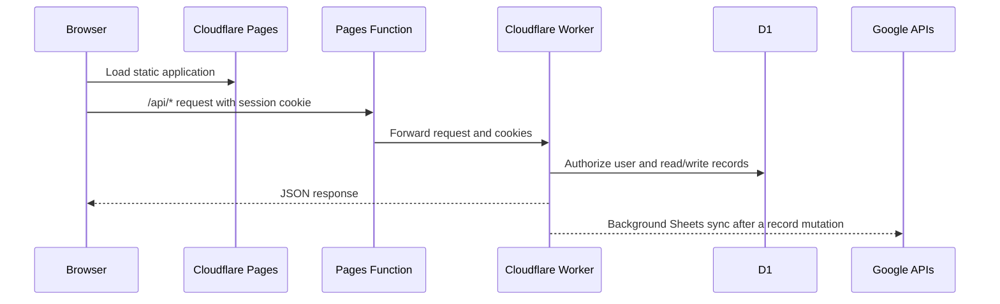

# Architecture

## Runtime topology

## Responsibilities

| Component | Responsibility |
| --- | --- |
| `src/app` and `src/components` | Static user interface, PDF generation, filters, theme, and form behavior. |
| `functions/api/[[path]].ts` | Same-origin proxy from Pages to the Worker, preserving cookies. |
| `worker/src/index.ts` | OAuth, signed sessions, tenant authorization, D1 queries, suggestions, and Google Sheets synchronization. |
| Cloudflare D1 | Primary application data store. Every record query and filter reads from here. |
| Google Sheets | Per-user synced copy of records; the Worker finds or creates the spreadsheet when needed. |

## Data ownership

Every protected Worker route derives the current user from the signed `nexdesk_session` cookie and scopes database queries to that user. Suggestions use the same scope, so one account cannot see another account's worker or location history.

Records are written to D1 first. The Worker then schedules the Google Sheets sync using `waitUntil`, so a slow Google request does not delay the record response.

## History performance

The records endpoint filters in D1 before applying `limit` and `offset`. The history page renders a bounded page of results, while filters still operate over the user’s complete record set.
